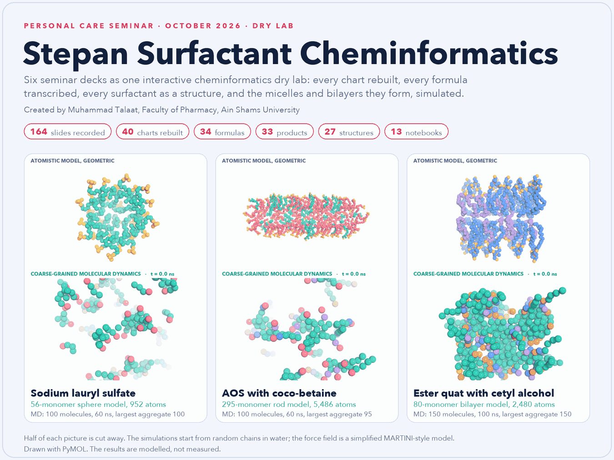

# Stepan Surfactant Cheminformatics

**Created by Muhammad Talaat, Faculty of Pharmacy, Ain Shams University** (ORCID [0000-0002-9171-437X](https://orcid.org/0000-0002-9171-437X))

**The surfactants and conditioning actives of the Stepan personal care customer seminar of October 2026 as structures, physical chemistry, formulations and molecular dynamics: a cheminformatics dry lab.**

<p align="center">
  <picture>
    <source media="(prefers-color-scheme: dark)" srcset="docs/card/stepan_card_animated-dark.gif">
    
  </picture>


[Open the interactive page](https://mohamedtalaat-gif.github.io/Stepan_Surfactant_Cheminformatics/card/): turn a micelle, cut it open, switch between the sphere, the rod and the bilayer, play the molecular dynamics in which random chains assemble into micelles and a bilayer, colour the atoms by species, element or renewable carbon, and look at any of the 27 structures in 3D. GitHub does not run scripts in a README, so the interactive version is a page of its own. The same viewer is inside the notebooks, where you can also build an aggregate of your own and run a simulation of your own.

> **A note on the decks.** The six decks are Stepan Company's. Azelis published them for the participants of the Stepan personal care customer seminar of October 2026 at
> <https://explore.azelis.com/en_GB/stepan-personal-care-customer-seminar-october-2026>. That page states no licence, so the decks are not open source and nothing in this repository gives anyone rights in them. The code, the notebooks, the models and
> the simulations are mine and are under the MIT licence.

A cheminformatics dry lab built from the Stepan personal care seminar decks. I attended the seminar as a
consultant and rebuilt it so that a colleague who could not attend can work through the same material. Every chart of the slides is
redrawn from the geometry inside the slide, every formula is transcribed with its page, every surfactant has a drawn structure,
and every claim that can be recomputed has been. The notebooks run in the browser; nothing has to be installed by hand.

| Content | In the lab |
|---|---|
| Slides recorded | 164, from six decks |
| Charts rebuilt | 40, each with its data as a CSV file in `data/charts/` |
| Formulas transcribed | 34, with process steps and page references |
| Products registered | 33, with INCI name, class, charge and printed properties |
| Structures drawn | 27, with renewable carbon marked, each also as a 3D model |
| Notebooks | a start page, six session notebooks (S1, S2, S3, S4, S6, S7) and six labs |

## Start without a terminal

You need a computer with an internet connection (once, for the first start), about 1 GB of free disk space and a web browser.
The lab runs on your own computer; nothing is uploaded.

1. On the GitHub page of this project press the green **Code** button, then **Download ZIP**.
2. Unzip the file. On Windows use *right-click, Extract All*; do not run anything from inside the ZIP.
3. Open the unzipped folder and double-click the start file for your system:

| System | Start file | Stop file |
|---|---|---|
| Windows | `Start Dry Lab.bat` | `Stop Dry Lab.bat` |
| macOS | `Start Dry Lab.command` | `Stop Dry Lab.command` |
| Linux | run `sh scripts/start.sh` once in a terminal | `sh scripts/stop.sh` |

4. The first start downloads what the lab needs (a Python runtime and the packages, about 900 MB in all) into the project folder
   and takes about five minutes. A window shows the three steps. When it finishes, the lab opens in your browser. Later starts take a
   few seconds and download nothing.
5. When you have finished, double-click the stop file. To remove the lab completely, delete the folder.


**macOS** may say that Apple could not verify the file. Control-click (right-click) the start file, choose *Open*, and confirm. If the menu offers no *Open*, go to *System Settings, Privacy & Security* and press *Open Anyway* for the file. This is needed once. A second route that avoids the warning is to open *Terminal* and type `sh ` (with a space), drag the start file into the window and press Return.

**Windows** may show *Windows protected your PC* because the file is not signed. Press *More info*, then *Run anyway*. If a message names `VCRUNTIME140.dll`, install the free [Microsoft Visual C++ Redistributable](https://aka.ms/vs/17/release/vc_redist.x64.exe) once and start again. Windows computers with an Intel or AMD processor are supported; on Windows for ARM some of the scientific packages have no ready-made version.

If the lab does not start, the folder holds `.lab.log` (and `.lab.err.log` on Windows) with the reason. The usual causes are no internet
connection during the first start, or a security program that blocks the downloads; start again once either is fixed.

## Start from a terminal

```bash
git clone <address of this repository>
cd Stepan_Surfactant_Cheminformatics
sh scripts/start.sh                      # Windows: powershell -File windows\start.ps1
```

or, with [uv](https://docs.astral.sh/uv/) already installed:

```bash
uv sync
uv run python -m uvicorn server:app --port 2718      # the start page is at http://127.0.0.1:2718/
```

Tests and notebook checks:

```bash
uv sync --extra dev
uv run pytest
uv run marimo check notebooks/*.py
uv run python scripts/audit_controls.py      # changes every control of every notebook and lists those that change nothing
```

To host it on a server, the `Dockerfile` serves the same application: `docker build -t surfactant-cheminformatics .` and `docker run -p 2718:2718 surfactant-cheminformatics`.

## What is in it

The start page lists everything. Each session notebook follows one deck and has five tabs: *The session* (what it argued and what to
keep in mind), *Dry lab* (numbers you can move), *Every slide* (all slides in order, with their data), *Check yourself* and *Data*.

| Notebook | Subject |
|---|---|
| S1 | When sulfate free is the economical solution: alpha olefin sulfonate, six thickening hacks, six prototypes |
| S2 | Mastering modern hair care: market, ALPHA-STEP PC-48 claims, sulfoacetates, seven formulas |
| S3 | STEPANBLEND ASF/MB: one blend, three formulas, colour fade, combing and mildness |
| S4 | Advanced colour protection: surfactant screening, anionic-free systems, cleansing conditioner |
| S6 | Ester quats in hair conditioners: BTAC and CTAC substitutes, bio-based boosters |
| S7 | Sustainably sourced ingredients: STEPANQUAT Soleil, claim substantiation, formulation guidelines |
| Labs | molecules and physical chemistry; formulation arithmetic; salt curves; colour, foam and mildness; slide archive |

Deck 5 of the numbered series was not among the files I was given.

### How the lab uses marimo

Three ways I used [marimo](https://marimo.io) that other notebook authors may find useful. They are ways of using it, not additions to it.

1. **Every control checked.** `scripts/audit_controls.py` runs each notebook with the value of one control replaced and compares the rendered output of every cell, so a control that changes
   nothing, or only under some other setting, is listed. It found a surface-tension slider that moved nothing for most of the foam systems. It replaces `UIElement.value`, which is not a public
   interface of marimo, so it may need a change when marimo does.
2. **A complete 3D page inside a notebook.** `stepan_lab.viewer.page` builds one self-contained HTML page (3Dmol.js inlined, the data as JSON) and the notebooks show it with `mo.iframe`;
   the same page is the interactive card on GitHub Pages.
3. **One server for all the notebooks.** `server.py` serves the start page, the six sessions and the six labs from one process with `marimo.create_asgi_app().with_app(...)`; the start
   scripts and the Dockerfile run it.

### Three-dimensional models and molecular dynamics

The molecules lab shows every structure in three dimensions: RDKit embeds it (ETKDG), relaxes it with the MMFF94 force field and reports its radius of gyration and shape
descriptors. It also builds atomistic micelles and bilayers from those structures by placing relaxed monomers tail-in on a sphere, a rod or two sheets, with the number of monomers
taken from the packing model; those are **geometric models**, a picture of how a mixture fills space.

The **molecular dynamics lab** lets the assembly happen instead of building it. Every structure is coarse-grained into beads straight from its SMILES (about four heavy atoms per bead),
random chains are placed in explicit coarse-grained water, and OpenMM runs classical molecular dynamics (20 fs steps, 310 K, constant pressure). The micelles and bilayers that form are
measured on the trajectory: aggregation number, radius of gyration, asphericity, radial densities. The force field is a simplified version of the MARTINI scheme: bead sizes, interaction
levels and electrostatics follow the published scheme, the assignment of bead types to the head groups is my own, and nothing was fitted to any surfactant. The results therefore show how
the structures assemble in this model; they are not measurements and are labelled *modelled*. Three simulations (sodium lauryl sulfate; AOS with coco-betaine; ester quat with cetyl alcohol)
are stored in `docs/card/md/` and play in the interactive page; the lab also runs a new simulation on request (about a minute per nanosecond on a CPU, seconds with a graphics card).

The five atomistic models are PDB files in `docs/card/models/` with a PyMOL script (`stepan_lab.pml`); the B-factor column carries the renewable-carbon flag, and `molecules.sdf` holds all
27 structures. The animation at the top is drawn with PyMOL (`python scripts/render_card.py`, which needs PyMOL on the path): the atomistic models turn, and every frame of the lower row is a stored frame of a run from its random start to its end, not an interpolation. Still versions of the figure, `stepan_card-dark.png` and `stepan_card-light.png`, are in the same folder; the page and the models are rebuilt with
`python scripts/build_card.py`, and the simulations are repeated with `python scripts/run_md.py`. Neither the notebooks nor the page needs PyMOL.

### Four kinds of number

Every number on screen is labelled as one of: **reported** (printed on a slide), **digitised** (read from a drawing or a picture on a slide, with
the resolution stated), **derived** (arithmetic on reported numbers) or **modelled** (a textbook model that is not part of the seminar, with
assumptions that can be changed). A calculation is never shown as a measurement.

## How the data were obtained

The decks were exported from presentation software, so most charts are drawing instructions inside the PDF. `scripts/capture_charts.py`
reads those instructions and the axis tick labels, which gives values at the resolution of the drawing. `scripts/capture_raster.py` handles
the few charts that were pasted as pictures. Both can be re-run with the decks in `references/source_decks/` (`uv sync --extra capture`).
Where a slide prints a value beside a mark, the printed value is kept and the drawn value is stored next to it as a check.
Six pages of the supplied files held internal reviewer comments (S3 p20, S7 p2 and p3) or personal contact details (S4 p26, S6 p12 and S7 p32). In the copies kept in `references/source_decks/`
I blanked those pages (the page numbers are unchanged) and cleared the author fields of the files; `data/` and the notebooks do not reproduce them (`python scripts/redact_decks.py`). The files I was given are otherwise as presented.

## Layout

```text
notebooks/        start page, six session notebooks, six labs (marimo)
src/stepan_lab/   molecules, physical chemistry, formulation, rheology, colour, charts, interface
data/             products, formulas, process steps, claims, slide ledger, charts/ (one CSV per chart)
docs/card/        the interactive 3D page, its models (PDB, SDF, PyMOL script) and the pictures above
scripts/          chart capture from the PDFs; 3D page and pictures; start and stop scripts
windows/          Windows start and stop scripts
tests/            pytest suite
references/       source register and the supplied decks
server.py         serves all notebooks from one process
```

## Limits

The lab does arithmetic on printed percentages. It does not predict viscosity, stability, mildness, colour retention or sensory
performance of a changed formula, and a modified formula has to be tested in the laboratory and checked for safety and regulatory status.

## Credits and sources

**The seminar.** The decks and the formulations are Stepan Company's. They were presented at the Stepan personal care customer seminar of October 2026 and published for its
participants by Azelis at <https://explore.azelis.com/en_GB/stepan-personal-care-customer-seminar-october-2026>, which lists the six decks I worked from. I attended as a consultant.
That page states no licence, so the decks are not offered here under one: see [`CONTENT_NOTICE.md`](CONTENT_NOTICE.md).

**Software this lab stands on.** [marimo](https://marimo.io) (the notebooks), [RDKit](https://www.rdkit.org) (structures, descriptors, conformers), [OpenMM](https://openmm.org)
(molecular dynamics), [3Dmol.js](https://3dmol.org) (the interactive 3D view), [PyMOL](https://pymol.org) (the pictures at the top), NumPy, SciPy, pandas, Altair and PyMuPDF (reading the decks).

**Methods.** Coarse-grained force field after Marrink et al., *J. Phys. Chem. B* 111, 7812 (2007); OpenMM after Eastman et al., *PLoS Comput. Biol.* 13, e1005659 (2017); critical
packing parameter after Israelachvili, Mitchell and Ninham (1976) with chain geometry from Tanford (1972); critical micelle concentration after Klevens (1953) and Mukerjee and Mysels (1971);
micellisation free energy after Zana (1980); hydrophilic-lipophilic balance after Griffin (1954); electrolyte screening after Debye and Hueckel (1923); colour difference CIEDE2000 after Sharma,
Wu and Dalal, *Color Res. Appl.* 30, 21 (2005).

## Licence, content and citation

The code is under the MIT licence. The interactive page includes 3Dmol.js (BSD-3-Clause), kept with its licence in `docs/card/vendor/`; the packages the lab installs (marimo, RDKit, OpenMM, NumPy, SciPy, pandas, Altair) keep their own licences and none of their code is copied into this repository. Product names, formulations, charts and test results come from Stepan Company material and remain
subject to the terms under which it was supplied; see [`CONTENT_NOTICE.md`](CONTENT_NOTICE.md) and
[`references/source_register.md`](references/source_register.md). The models, notebooks and explanatory text are my own work and are
not Stepan statements.

To cite: Muhammad Talaat, Faculty of Pharmacy, Ain Shams University (ORCID 0000-0002-9171-437X). Stepan Surfactant Cheminformatics, version 1.0.0.
The machine-readable form is `CITATION.cff`.
